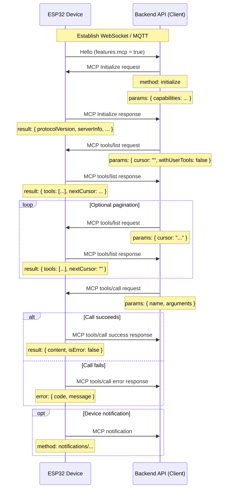

# MCP (Model Context Protocol) Interaction Flow

NOTICE: This document was AI-assisted; when implementing a backend, always cross-check the details against the code.

In this project, MCP is used between the backend API (MCP client) and the ESP32 device (MCP server) to let the backend discover and invoke the device's capabilities (tools).

## Message Format

From `main/protocols/protocol.cc` and `main/mcp_server.cc`, MCP messages are wrapped inside the underlying transport (WebSocket or MQTT). The inner payload follows the [JSON-RPC 2.0](https://www.jsonrpc.org/specification) specification.

Overall message layout:

```json
{
  "session_id": "...",   // session id
  "type": "mcp",         // fixed value "mcp"
  "payload": {           // JSON-RPC 2.0 payload
    "jsonrpc": "2.0",
    "method": "...",     // method name ("initialize", "tools/list", "tools/call", ...)
    "params": { ... },   // arguments (for requests)
    "id": ...,           // request id (for requests and responses)
    "result": { ... },   // success result (response)
    "error": { ... }     // error (response)
  }
}
```

The `payload` follows standard JSON-RPC 2.0:

- `jsonrpc`: always `"2.0"`.
- `method`: the method name (requests).
- `params`: structured parameters, usually an object (requests).
- `id`: request identifier; echoed back in responses.
- `result`: success value (responses).
- `error`: error information (responses).

## Interaction Flow

MCP interactions are driven by the client (backend) discovering and invoking tools on the device.

1. **Connection and capability announcement**

   - **When**: after the device boots and connects to the backend.
   - **Direction**: device -> backend.
   - **Message**: the device sends the transport hello, advertising supported capabilities. MCP support is signaled via `"mcp": true` in the `features` map.
   - **Example (transport hello, not an MCP payload):**
     ```json
     {
       "type": "hello",
       "version": 1,
       "features": {
         "mcp": true
       },
       "transport": "websocket",
       "audio_params": { ... },
       "session_id": "..."
     }
     ```

2. **Initialize the MCP session**

   - **When**: after the backend sees that the device supports MCP. Usually the first MCP request.
   - **Direction**: backend -> device.
   - **Method**: `initialize`
   - **Message (MCP payload):**
     ```json
     {
       "jsonrpc": "2.0",
       "method": "initialize",
       "params": {
         "capabilities": {
           // optional client capabilities
           "vision": {
             "url": "...",   // camera image upload endpoint (must be an http URL, not a websocket URL)
             "token": "..."  // token for the upload URL
           }
           // ... other client capabilities
         }
       },
       "id": 1
     }
     ```

   - **Device response:**
     ```json
     {
       "jsonrpc": "2.0",
       "id": 1,
       "result": {
         "protocolVersion": "2024-11-05",
         "capabilities": {
           "tools": {}
         },
         "serverInfo": {
           "name": "...",    // device name (BOARD_NAME)
           "version": "..."  // firmware version
         }
       }
     }
     ```

3. **Discover the tools**

   - **When**: whenever the backend needs the list of callable tools and their signatures.
   - **Direction**: backend -> device.
   - **Method**: `tools/list`
   - **Request parameters**:
     - `cursor` (string, optional): pagination cursor. Empty on the first request.
     - `withUserTools` (boolean, optional, default `false`): if `true`, the device also includes "user-only" tools (see "User-only tools" below) in the listing. This is typically used by a companion app that lets the user trigger privileged actions directly.
   - **Message (MCP payload):**
     ```json
     {
       "jsonrpc": "2.0",
       "method": "tools/list",
       "params": {
         "cursor": "",
         "withUserTools": false
       },
       "id": 2
     }
     ```
   - **Device response:**
     ```json
     {
       "jsonrpc": "2.0",
       "id": 2,
       "result": {
         "tools": [
           {
             "name": "self.get_device_status",
             "description": "...",
             "inputSchema": { ... }
           },
           {
             "name": "self.audio_speaker.set_volume",
             "description": "...",
             "inputSchema": { ... }
           }
           // ... more tools
         ],
         "nextCursor": "..."
       }
     }
     ```
   - **Pagination**: when `nextCursor` is non-empty, the backend must send another `tools/list` request with that cursor to fetch the next page.

4. **Call a tool**

   - **When**: the backend wants to execute a specific device function.
   - **Direction**: backend -> device.
   - **Method**: `tools/call`
   - **Message (MCP payload):**
     ```json
     {
       "jsonrpc": "2.0",
       "method": "tools/call",
       "params": {
         "name": "self.audio_speaker.set_volume",
         "arguments": {
           "volume": 50
         }
       },
       "id": 3
     }
     ```
   - **Successful response:**
     ```json
     {
       "jsonrpc": "2.0",
       "id": 3,
       "result": {
         "content": [
           { "type": "text", "text": "true" }
         ],
         "isError": false
       }
     }
     ```
   - **Error response:**
     ```json
     {
       "jsonrpc": "2.0",
       "id": 3,
       "error": {
         "code": -32601,
         "message": "Unknown tool: self.non_existent_tool"
       }
     }
     ```

5. **Device-initiated notifications**

   - **When**: the device wants to inform the backend of internal events (e.g. state transitions). `Application::SendMcpMessage` is the outbound entry point.
   - **Direction**: device -> backend.
   - **Method**: conventionally `notifications/...` or any custom method.
   - **Message (MCP payload)**: JSON-RPC notifications have no `id`.
     ```json
     {
       "jsonrpc": "2.0",
       "method": "notifications/state_changed",
       "params": {
         "newState": "idle",
         "oldState": "connecting"
       }
     }
     ```
   - **Backend handling**: process the notification without replying.

## User-only Tools

The MCP server on the device maintains two kinds of tools:

- **Regular tools** - registered via `McpServer::AddTool`. Exposed to the backend (and hence the AI model) by default.
- **User-only tools** - registered via `McpServer::AddUserOnlyTool`. These are hidden from standard `tools/list` results, because they are privileged or user-facing actions that should not be invoked autonomously by the AI. Examples include system reboot, firmware upgrade, and screen snapshot upload.

The backend opts in to user-only tools by sending `tools/list` with `params.withUserTools = true`. Typical usage: a companion app screen that exposes these actions to the end user.

See [MCP IoT control usage](./mcp-usage.md) for how to register either kind of tool on the device side.

## Sequence Diagram

A simplified diagram of the main MCP message flow:



This document summarizes the MCP interaction flow in this project. For exact parameter shapes, behavior, and available tools, refer to `McpServer::AddCommonTools` / `AddUserOnlyTools` in `main/mcp_server.cc` and the per-board `InitializeTools` implementations.


## 知识库图片全屏显示

固件提供普通（对 AI 可见）工具 `self.screen.show_image`，参数为 `url`。
知识库检索在服务端完成：用户询问图片时，先检索对应图片记录，找到后返回可由设备访问的
HTTP/HTTPS 图片直链，并调用设备工具；仅将网址写入聊天文本不会打开弹窗。
未找到图片时应说明没有匹配结果，不要编造网址。本仓库不包含知识库服务端，需在服务端
提示词或检索工作流中接入这一步。

MCP 请求（内层 payload，WebSocket 和 MQTT/UDP 使用相同内容）：

```json
{
  "jsonrpc": "2.0",
  "id": 42,
  "method": "tools/call",
  "params": {
    "name": "self.screen.show_image",
    "arguments": {"url": "https://your-image-host.example/knowledge/example.png"}
  }
}
```

- 支持 LVGL 彩色屏幕，独立于截图配置与聊天显示风格。OLED、无屏幕、Emote 显示不注册此工具。
- 支持 PNG 和基线 JPEG；原始 ESP32 目标仅支持 PNG。不支持渐进 JPEG、网页链接或需要登录的图片。
- 图片文件最多 1 MiB，宽高各最多 2048 像素，总像素最多 1048576。建议服务端按屏幕尺寸生成缩略图，避免内存不足。
- 有 PSRAM 的设备仅在 PSRAM 分配图片下载缓冲区，PSRAM 不足时返回错误；无 PSRAM 的目标使用片内 RAM。
- 新增弹窗显示和关闭操作必须成功获取显示锁；点击回调由 LVGL port 的锁保护，图片释放调度到主任务后再次加锁。
- 下载在低优先级后台线程进行，一次最多下载一张；重复并发请求返回错误。单次读取超时为 10 秒，下载循环期限为 30 秒。
- 弹窗覆盖整个实际屏幕，图片居中、保持比例并铺满屏幕，超出屏幕的边缘会被裁切；右上角关闭按钮覆盖于图片之上。关闭时隐藏并复用弹窗控件；关闭或替换图片时先解绑图片来源，再释放图片及解码缓存。
- 下载或解码失败保留原弹窗并通过 MCP 返回错误；成功结果为 `true`。设备需要已有的触摸/指针输入才能点击关闭按钮。

服务端提示词示例：

> 用户要求查看某个图片时，先检索知识库。如果找到匹配图片，使用其可访问的图片直链调用
> self.screen.show_image，并告诉用户图片已展示。知识库没有匹配图片时说明未找到。

硬件验收：在触摸屏上分别测试横图、竖图、PNG/JPEG、重复展示与关闭；确认弹窗尺寸与
屏幕相同、关闭后恢复聊天界面，播放语音时下载不会阻塞主事件循环。再测试 404、截断响应、
超大文件、损坏图片、无匹配结果，以及 WebSocket 和 MQTT/UDP 两种连接下的工具调用。
