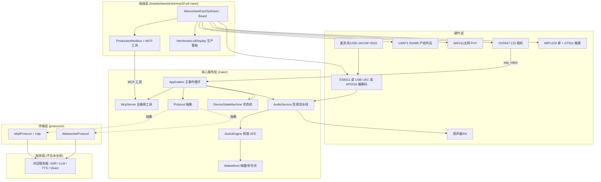
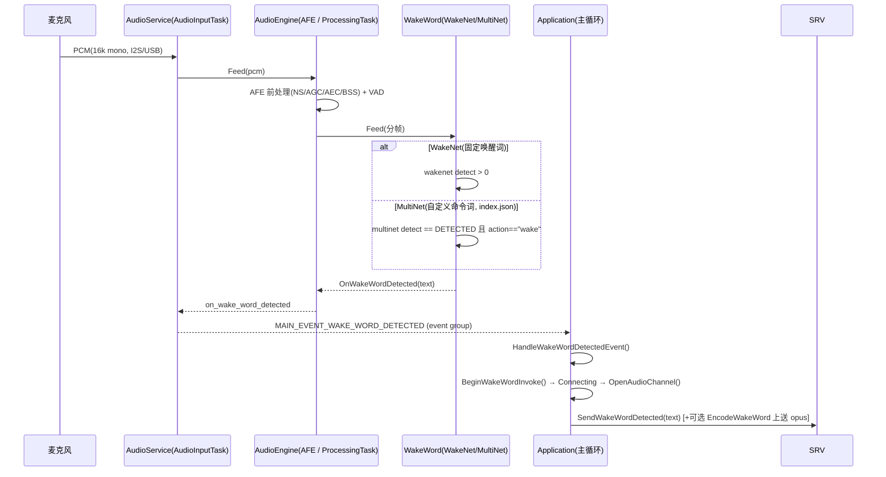
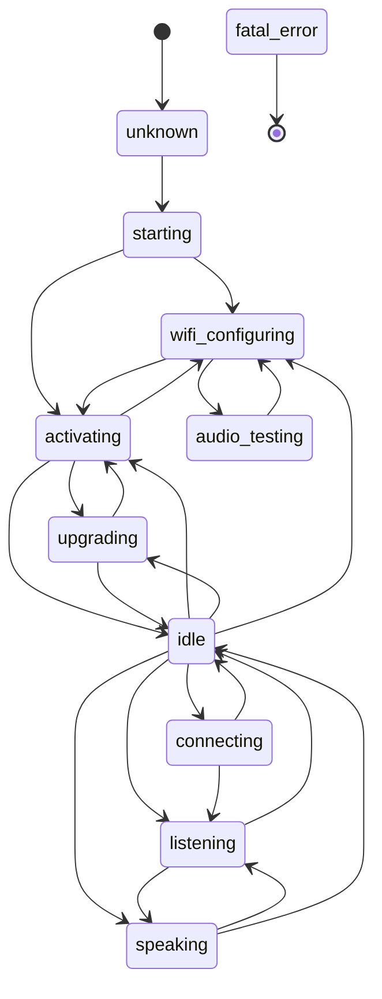
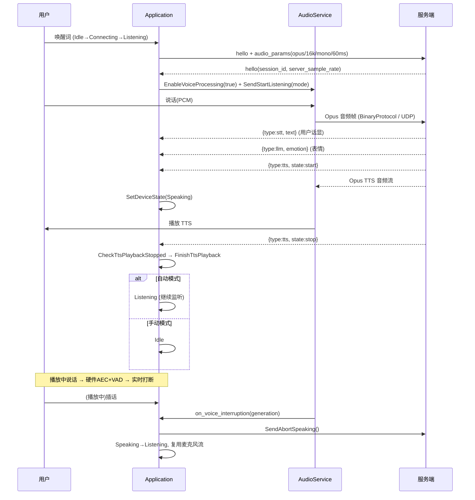
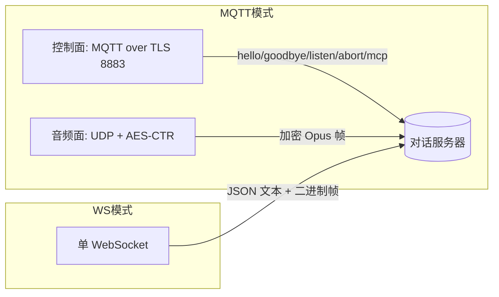

# XiaoZhi ESP32 固件架构深度分析

> 目标板：`waveshare/esp32-p4-nano`（ESP32-P4，10.1 寸 MIPI-DSI 屏 / 8.8 寸 OTA7290B，OV5647 相机，可接 AP-0316 音频前端，含产线 Modbus/生产看板）
> 分析对象：`main/` 下应用主循环、状态机、音频服务、唤醒词、协议层、板级实现
> 说明：本文件是对代码逐行核对后的结论，非泛泛而谈。所有要点均可在 `main/` 对应 `.cc/.h` 中验证。

---

## 0. 分析方法与边界（深度思考协议落地）

按"问题解构 → 意图推测 → 多视角审视 → 信息缺口 → 综合输出"的协议执行：

- **核心目标**：把 XiaoZhi 的"唤醒 / 对话 / 通信 / 模型"四条主线讲清楚，并补充用户易忽略的系统级内容，沉淀为单篇文档。
- **关键约束**：一份固件（C/C++，ESP-IDF，传输无关设计），所有 AI 大模型在**服务端**，设备侧只做"采集—前处理—传输—播放"与"本地唤醒/命令词"。
- **信息缺口自陈**：本仓库不含服务端代码，因此 ASR/LLM/TTS 的具体模型选型、服务器握手语义细节以本协议层暴露的 JSON 字段为准；相机图像上送路径以板级 `esp_video` + 协议能力声明为依据推断。
- **输出原则**：优先给出"准确且可验证"的结论，对存疑处显式标注，避免绝对化。

---

## 1. 系统总览（分层架构）

XiaoZhi 采用"传输无关的协议抽象 + 板级工厂"架构，核心永远依赖 `Board` 接口而非具体板卡。

**关键设计纪律**（来自 `AGENTS.md`）：
- 构建链：`config.json → scripts/build.py → Kconfig.projbuild → CMakeLists.txt → 板源文件`，每个板必须 `DECLARE_BOARD(...)` 导出唯一工厂，且**不得改动其它板的引脚**（OTA 兼容性依赖板身份）。
- `Core` 只依赖 `Board` 接口，绝不反向依赖具体板 `config.h`。
- 回调可能跑在非主任务线程，设备状态变更必须走 `Application::SetDeviceState()` 与状态机，跨任务变更用 `Schedule()`。

---

## 2. 唤醒链路（Wake-up）

### 2.1 数据流与判定

### 2.2 实现要点

- **本地唤醒模型有两套实现**（`main/audio/wake_words/`）：
  - `EspWakeWord`：基于 ESP-SR **WakeNet**（`ESP_WN_PREFIX`），`DET_MODE_95` 阈值；检测到即 `running_=false` 停止，回调文本为词名。
  - `CustomWakeWord`：基于 ESP-SR **MultiNet**（`ESP_MN_PREFIX`），命令词来自 `index.json`（`commands[].action=="wake"` 才触发唤醒，其余可作为本地命令）。支持 `duration_`、`threshold_` 配置。
- **真正的"前端"是 AFE**：`AfeAudioEngine` 包装 `esp_afe_sr_iface_t`，在 `ProcessingTask` 中统一完成 **降噪(NS) + 自动增益(AGC) + 回声消除(AEC) + 盲源分离(BSS) + VAD + 唤醒检测**。`IsAfeWakeWord()` 返回 `HasWakeWord()`，决定"播放中能否被二次唤醒"。
- **唤醒词音频可上送**：`CONFIG_SEND_WAKE_WORD_DATA` 时，`CustomWakeWord::EncodeWakeWordData()` 用独立任务把唤醒前缓存的 PCM 编码为 Opus 经 `PopWakeWordPacket()` 上送，供服务端上下文/二次校验。
- **唤醒即打断**：在 `Speaking/Listening` 状态再唤醒会走 `AbortSpeaking(kAbortReasonWakeWordDetected)` 并清空发送队列残留，重发 `SendStartListening`。
- 唤醒检测在 **Idle** 态默认开启（`HandleStateChangedEvent` 进入 Idle 时 `EnableWakeWordDetection(true)`），监听态是否保留见下节。

---

## 3. 对话流程（Conversation Lifecycle）

### 3.1 设备状态机（唯一事实来源）

> 转移表由 `DeviceStateMachine::IsValidTransition()` 硬编码；非法转移被拒绝并打 `ESP_LOGW`。所有状态变更通过 `Application::SetDeviceState()`，变更后广播 `MAIN_EVENT_STATE_CHANGED` 给监听者（LED、显示、音频服务）。

### 3.2 一次完整对话（监听 → 识别 → 回答 → 打断）

### 3.3 三类监听模式（ListeningMode）

| 模式 | 含义 | 触发条件 | 结束行为 |
| --- | --- | --- | --- |
| `kListeningModeRealtime` | 实时双向，播放中可被打断（需 AEC） | AEC 开启或支持语音打断 | 回到 `Listening` 继续听 |
| `kListeningModeAutoStop` | 说完自动停止，VAD 静音结束 | AEC 关闭且不支持打断时的默认 | TTS 后回到 `Listening` |
| `kListeningModeManualStop` | 手动按键挂断 | 按钮/UI 主动开启 | TTS 后回到 `Idle` |

- `GetDefaultListeningMode()` 逻辑：**AEC 关闭且不支持语音打断 → AutoStop**；否则 → **Realtime**。`aec_mode_` 来自 `CONFIG_USE_DEVICE_AEC` / `CONFIG_USE_SERVER_AEC`（二者互斥，否则编译报错）。
- **语音打断（Voice Interruption）**：仅在支持打断时启用。播放中 AFE/VAD 持续采集，确认到连续语音（`AUDIO_VOICE_INTERRUPTION_MIN_SPEECH_MS`）后经 `HandleVoiceInterruption(generation)` 发 `abort` 并切回 `Listening`。AP-0316 走**硬件 AEC**，P4 边采集边发，由服务端承接实时流。
- **TTS 准入控制（epoch / generation）**：网络乱序是真实风险——协议**没有 response id**。代码用 `incoming_tts_epoch_`（自增计数器）+ `playback_generation_`（OPUS 解码代次）+ 有限 `PLAYBACK_DRAIN_MS` 静默窗口来隔离"旧响应尾包/迟到 UDP 包"与"新响应"。`HandleStateChangedEvent` 进入非 Speaking 会 `DisarmVoiceInterruption()`；`CheckTtsPlaybackStopped()` 在解码队列与在途播放都排空后才 `FinishTtsPlayback()`。

### 3.4 文本与表情

- 服务端下发的 `stt`/`tts`/`llm` JSON 分别驱动**用户气泡、助手气泡、表情(emotion)**。
- **字库推送（glyph_push）**：若板级支持（`AddTextFontCapabilities`），hello 时上报字体 bundle/charset/size/bpp，服务端可在 `sentence_start` 中附带 `glyphs`（点阵），由 `TextGlyphPayload` 解析、显示侧 `AddTextGlyphs` 离线渲染——避免依赖网络字体。

---

## 4. 通信协议（Communication）

### 4.1 两种传输，传输无关

`Protocol` 是纯虚基类；`Application::InitializeProtocol()` 按 **OTA 配置**选择：有 MQTT 配置 → `MqttProtocol`；有 WebSocket 配置 → `WebsocketProtocol`；都没有 → 默认 MQTT。

### 4.2 握手与协商

- **Client hello**（`GetHelloMessage`）：`type=hello`、`version`、`transport`（websocket/udp）、`features{aec, mcp}`、`audio_params{format:opus, sample_rate:16000, channels:1, frame_duration:60}`、可选 `text_font`（字库能力）。
- **Server hello**（`ParseServerHello`）：回 `session_id`、`audio_params`（最终采样率/帧长），MQTT 模式还回 `udp{server, port, key, nonce}`。
- 握手在 `OpenAudioChannel()` 内用 `xEventGroupWaitBits(..., 10000ms)` 等 `SERVER_HELLO_EVENT`；超时即 `SERVER_TIMEOUT`。

### 4.3 二进制封装

- **WebSocket**：`version_==2` → `BinaryProtocol2{version(ntohs), type, reserved, timestamp(ntohl), payload_size(ntohl), payload}`；`version_==3` → `BinaryProtocol3{type, reserved, payload_size(ntohs), payload}`（无 timestamp，AEC 用）；其它 → 裸 Opus。
- **MQTT/UDP**：音频走独立 UDP 通道，每包 16 字节头（`type=0x01, flags, payload_len(2), ssrc(4), timestamp(4), sequence(4)`）+ AES-CTR 密文；接收端按 `sequence` 去重/排序。

### 4.4 安全与韧性

- **AES-CTR 128**：密钥/nonce 由服务端在 hello 的 `udp` 中下发（hex），经 PSA Crypto（`psa_import_key`, `PSA_ALG_CTR`）导入；每包用 `nonce` 嵌入 `payload_len/timestamp/sequence` 后作为 CTR IV 加密。**无 MAC**（仅 CTR 流密码，不提供完整性校验）。
- **鉴权**：WebSocket 在 `Authorization` 头加 `Bearer <token>`；设备附加 `Device-Id`(MAC)、`Client-Id`(UUID)、`Protocol-Version`。
- **重连/超时**：MQTT 断线 `OnDisconnected` 启动 60s 重连定时器（`MQTT_RECONNECT_INTERVAL_MS`）；`IsTimeout()` 判定 120s 无下行即超时；`SERVER_HELLO_EVENT` 缺失判定握手失败。`goodbye` 双向去抖，避免 ping-pong。

### 4.5 控制 JSON 命令族（协议中性，两个传输共用）

`listen{detect/start/stop, mode}`、`abort{reason:wake_word_detected}`、`stt`、`tts{start/stop/sentence_start}`、`llm{emotion}`、`mcp{payload}`、`system{reboot}`、`alert`、`custom`（可选 `CONFIG_RECEIVE_CUSTOM_MESSAGE`）。

---

## 5. 用到的模型（Models）

| 类别 | 名称 | 位置 | 说明 |
| --- | --- | --- | --- |
| 唤醒 | **WakeNet** | 本地（ESP-SR，`model` 分区） | `EspWakeWord`，固定唤醒词，`DET_MODE_95` |
| 命令词 | **MultiNet** | 本地（ESP-SR） | `CustomWakeWord`，`index.json` 配置命令/阈值/语言 |
| 前端 | **AFE 套件** | 本地（ESP-SR `esp_afe_sr_models`） | NS/AGC/AEC/BSS + VAD，由 `AfeAudioEngine` 调用 |
| 编解码 | **Opus** | 本地（`esp_opus_enc/dec`） | 16k mono，帧长 60ms，VBR+DTX+无 FEC |
| ASR | — | **服务端** | 语音→文本（`stt`），协议仅传 Opus |
| LLM | — | **服务端** | 对话理解与生成（`llm` emotion 透传） |
| TTS | — | **服务端** | 文本/情感→Opus 音频流（`tts`） |
| 视觉 | — | **服务端** | OV5647 采集经 `esp_video` 上送，服务端做视觉理解 |

**重要澄清**：本固件是**端侧采集+前处理+传输+播放**终端，**所有"大模型"（ASR/LLM/TTS/Vision）均运行在服务端**，固件不内置也不指定其具体型号；模型选型在服务器侧配置。设备侧"模型"严格限定为 ESP-SR 唤醒/命令词/AFE 与 Opus 编解码。唤醒模型来自 `model` 分区（由 OTA `assets` 下载/应用）。

---

## 6. 你大概率没想到的部分（系统级补充）

1. **状态机是"法律"而非装饰**：非法 `TransitionTo` 被拒绝，所有组件通过监听器对状态变化做出反应。所谓"唤醒即对话"只是 Idle→Connecting→Listening 的一条路径，还有 `wifi_configuring / audio_testing / activating / upgrading / fatal_error` 等分支。
2. **AEC 是全局开关，且互斥**：`DEVICE_AEC` 与 `SERVER_AEC` 不能同时开（编译期 `#error`）。**没有 AEC 就没有"实时打断"**，默认退化到 AutoStop。AP-0316 走硬件 AEC，与软件 `CONFIG_USE_DEVICE_AEC` 不是一回事。
3. **"打断"是最复杂的一块**：硬件 AEC + 本地 VAD + `generation/epoch` 准入 + 有限 drain 窗口，共同解决"播放中插话"与"网络包乱序"。README 明确承认协议无 response id，"有限 drain 只能减少尾包重排，不能绝对隔离"。
4. **音频流水线双路 + 背压死锁防护**：`MIC→Engine→Encode→SendQueue→Server` 与 `Server→Decode→Playback→Speaker`。`MAIN_EVENT_SEND_AUDIO` 发送失败时**必须丢弃整条发送队列**，否则 Opus 编码任务会因等待队列空间而永久阻塞、拖垮整条输入管线（代码注释里有专门说明）。
5. **OTA 激活是独立大流程**：`Activating` 态会 `CheckAssetsVersion()`（下载/应用资源）、`CheckNewVersion()`（版本比对+重试退避×10、`MarkCurrentVersionValid`）、`Activate()`（配网码/挑战）、`InitializeProtocol()`。OTA 期间切换 `PERFORMANCE` 供电。
6. **设备侧 MCP 工具 + 产线 Modbus 是隐藏主线**：`McpServer` 把 `self.get_device_status`、`self.audio_speaker.set_volume`、`self.screen.set_brightness/theme`、`self.screen.show_image` 等作为工具下发给 LLM，让 AI 直接控制设备。本板还额外注册 **Production Modbus MCP**（`production_mcp_tools.cc`）：水阀开关、水温、灯光(0-100%)、四个料塔重量（silos，32 位有符号），经 UART1 RS485（9600/8N1，外部方向控制）。**这说明该板实际是"牧场/生产看板"终端**，而非普通音箱。
7. **Herdsman 生产看板 UI**：`HerdsmanLcdDisplay` 用 LVGL 画顶栏（品牌/设置/时钟/WiFi/电量/静音）、33 根橙色音频电平柱（PSRAM 画布，40Hz 刷新，仅监听态随音量起伏，纯装饰非频谱）、对话区、生产图表（演示数据，与 Modbus 未联网）。音频电平由 `HerdsmanAudioMeter` 经原子变量发布。
8. **低功耗与供电档位**：`board.SetPowerSaveLevel(LOW_POWER / PERFORMANCE)` 在激活、连接、对话、升级间切换；USB UAC 需注意端口供电电流， firmware 无法校验 USB 描述符与供电。
9. **NVS/Settings 持久化 + 字库能力协商**：`Settings` 按命名空间读写（`websocket`/`mqtt`/`assets`…）；`glyph_push` 让服务端推送离线点阵，断网也能正确显示中文/表情。
10. **构建链与板身份是 OTA 兼容性的根**：`config.json` 的 `target/builds[].name` 决定 `DECLARE_BOARD` 身份与分区；改引脚必须新增板而非改旧板。
11. **相机/多模态是可选扩展**：OV5647 经 CSI + SCCB 初始化（`esp_video`），在支持视觉的服务端配置下参与多模态；本板 `sdkconfig` 已开 `CONFIG_CAMERA_OV5647` 与 MIPI RAW8 800×800@50fps。

---

## 7. 潜在意图与设计取舍（多视角）

- **乐观视角**：传输无关 + 状态机 + 板工厂，使同一份核心可覆盖数十种硬件；AFE 把"唤醒+降噪+回声消除"打包，端侧体验门槛低；MCP 让 LLM 原生操控设备，扩展性强。
- **审慎视角**：协议无 response id、UDP 音频无 MAC（仅 AES-CTR，无完整性）、状态机非法转移静默拒绝——这些都要求服务端严格配合，且"打断/乱序"仅靠启发式窗口缓解，边界场景（双响应、重连竞态）仍有尾包风险；OTA 期间 `PERFORMANCE` 档位与供电/热相关。
- **本板特有风险**：产线 Modbus 默认 `kAutomaticPollingEnabled=false`（按需），设备地址默认 0（未配置即禁用），实际部署需先 `SetDeviceAddress(1..247)`；AP-0316 硬件 AEC 路径必须物理验证"播放中不误触发、插话首音节可达服务端、播放立即停止"。
- **最终目的的推断**：你要的并非"怎么编译"，而是"脑子里能跑通一条请求从麦克风到音箱再回到麦克风的全链路图"，以及"哪些坑会在量产/联调时咬人"。本文件即按此组织。

---

## 8. 验证状态与遗留风险

- **已可静态确认**：状态转移表、双协议封装、AES-CTR 流程、AFE 前处理、唤醒双实现、MCP/Modbus 工具、板级硬件链路。
- **需真机/服务端验证**（代码注释反复强调）：USB UAC 描述符与供电、AP-0316 硬件 AEC 打断全路径、两种传输对服务端 realtime/abort 的真实支持、MIPI 屏与触摸对齐、OTA 实际握手、Modbus 外设物理接线（RS485 方向控制）。

---

## 9. 关键文件索引

| 关注点 | 文件 |
| --- | --- |
| 主循环/对话编排 | `main/application.cc` / `.h` |
| 状态机 | `main/device_state_machine.cc` / `main/device_state.h` |
| 音频流水线 | `main/audio/audio_service.cc` / `.h` |
| 音频前端(AFE) | `main/audio/engines/afe_audio_engine.*` |
| 唤醒/命令词 | `main/audio/wake_words/esp_wake_word.*`、`custom_wake_word.*` |
| 协议抽象 | `main/protocols/protocol.cc` / `.h` |
| WebSocket | `main/protocols/websocket_protocol.cc` / `.h` |
| MQTT+UDP+加密 | `main/protocols/mqtt_protocol.cc` / `.h` |
| 设备侧 MCP | `main/mcp_server.cc` |
| 板级实现 | `main/boards/waveshare/esp32-p4-nano/esp32-p4-nano.cc`、`config.h`、`config.json` |
| 生产看板/Modbus | 同上 `herdsman_lcd_display.*`、`production_mcp_tools.*`、`production_modbus.*` |
| 板文档 | `main/boards/waveshare/esp32-p4-nano/README.md`、`docs/rs485_modbus_guide.md`、`ap0316-mode6.md` |
| 架构纪律 | `AGENTS.md`（仓库根）、`docs/custom-board.md` |

---

*生成方式：基于本仓库 `main/` 源码逐文件核对，含状态机、音频服务、协议层、板级实现与 README。所有结论均指向可验证的代码位置。*
